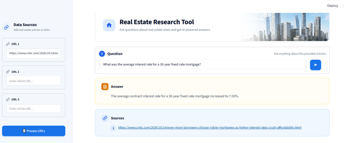

# 🏙️ **RealEstate Research Tool**


## Overview

The **Real Estate Research Tool** is a user-friendly, RAG-based application that helps users retrieve relevant information from real estate news articles. Users can provide article URLs, process their content, and ask questions to receive context-aware answers backed by the provided sources.

Built using LangChain, HuggingFace embeddings, ChromaDB, and Groq-powered LLMs, the tool streamlines information retrieval from multiple articles. Although initially designed for real estate research, its architecture can be extended to support other domains.


## Features

- **URL-Based Content Loading:** Fetch article content directly from user-provided URLs.
- **Document Processing:** Extract and process article content using LangChain's `UnstructuredURLLoader`.
- **Text Splitting:** Divide articles into smaller chunks to support efficient retrieval.
- **Embedding Generation:** Generate vector embeddings using HuggingFace embedding models.
- **Vector Storage and Retrieval:** Store embeddings in ChromaDB and retrieve relevant content based on user queries.
- **Question Answering:** Use Groq-hosted large language models to generate answers grounded in the retrieved article content.
- **Source References:** Display source URLs to help users trace answers back to the original articles.
- **Extensible Architecture:** Adapt the tool to other research domains by providing relevant article URLs.

## Technology Stack

- **Frontend:** Streamlit
- **LLM Orchestration:** LangChain
- **LLM Inference:** Groq
- **Embeddings:** HuggingFace
- **Vector Database:** ChromaDB
- **Article Extraction:** UnstructuredURLLoader
- **Language:** Python

## Setup and Installation

### 1. Clone the repository

```bash
git clone YOUR_GITHUB_REPOSITORY_URL
cd YOUR_PROJECT_FOLDER
```

Replace the placeholders with your actual GitHub repository URL and project folder name.

### 2. Install dependencies

Install the required Python packages:

```bash
pip install -r requirements.txt
```

### 3. Configure environment variables

Create a `.env` file in your project root and add your Groq credentials:

```env
GROQ_MODEL=your_groq_model_id
GROQ_API_KEY=your_groq_api_key
```

Replace the placeholders with a model ID supported by Groq and your actual API key.

**Security note:** Never upload your `.env` file or API key to GitHub. Add `.env` to `.gitignore`.

### 4. Run the application

Start the Streamlit application:

```bash
streamlit run main.py
```

The application will open in your browser.

## Usage

1. **Provide article URLs:** Enter real estate news article URLs in the sidebar.
2. **Process the articles:** Click **Process URLs** to fetch and prepare the article content.
3. **Generate embeddings:** The application splits the content into chunks and generates embeddings using the configured HuggingFace embedding model.
4. **Store the vectors:** The generated embeddings are stored in ChromaDB for similarity-based retrieval.
5. **Ask questions:** Enter a question related to the processed articles.
6. **Explore the answers:** The application retrieves relevant content, generates an answer using the configured Groq-hosted LLM, and displays the associated source URLs.

## Example Articles

The following articles can be used to explore the tool's capabilities:

- [How the Federal Reserve's rate policy affects mortgages — CNBC](https://www.cnbc.com/2024/12/21/how-the-federal-reserves-rate-policy-affects-mortgages.html)
- [Why mortgage rates jumped despite Fed interest rate cut — CNBC](https://www.cnbc.com/2024/12/20/why-mortgage-rates-jumped-despite-fed-interest-rate-cut.html)
- [Wall Street sees upside in 2025 for these dividend-paying real estate stocks — CNBC](https://www.cnbc.com/2024/12/17/wall-street-sees-upside-in-2025-for-these-dividend-paying-real-estate-stocks.html)

After processing the articles, try questions such as:

- How do Federal Reserve rate decisions affect mortgage rates?
- Why can mortgage rates rise even after an interest rate cut?
- What factors influence real estate stock performance?

## How It Works

The application follows a Retrieval-Augmented Generation (RAG) workflow:

**Article URLs → Content Extraction → Text Splitting → Embedding Generation → ChromaDB → Relevant Context Retrieval → LLM Answer Generation → Source References**

This approach enables the application to answer questions using information retrieved from the supplied articles rather than relying solely on the LLM's general knowledge.

---

**Disclaimer:** Answer quality depends on the content successfully extracted from the supplied URLs, the relevance of retrieved passages, and the selected language model.